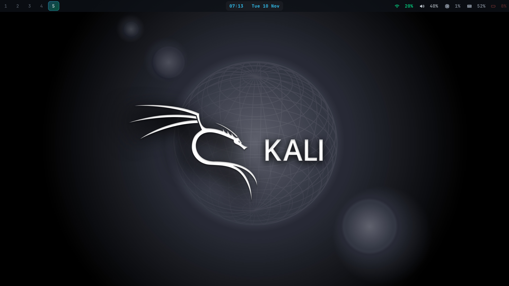
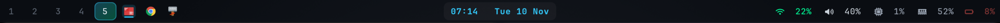
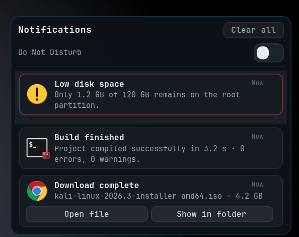
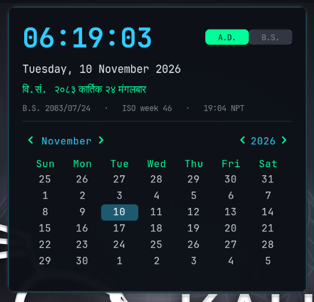
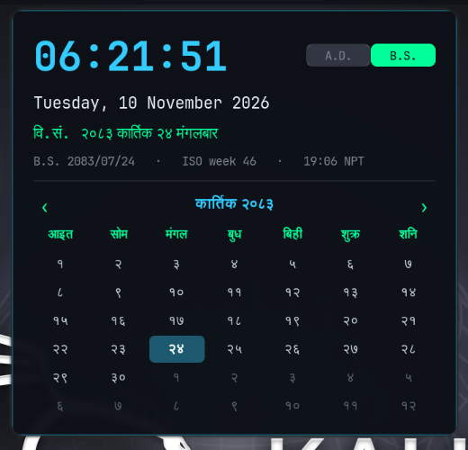
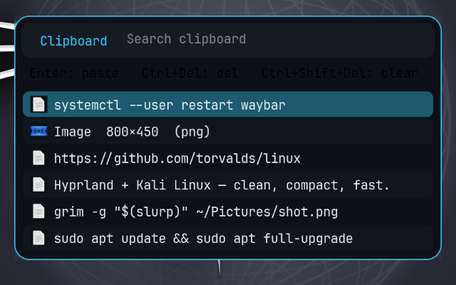
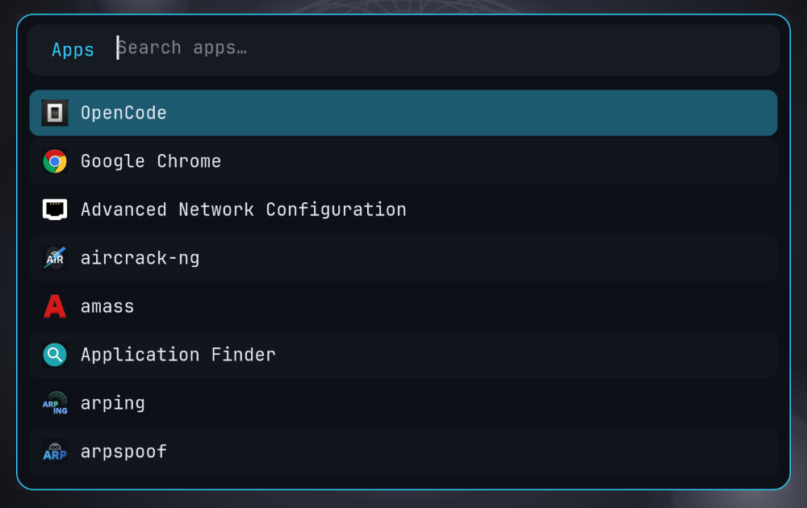
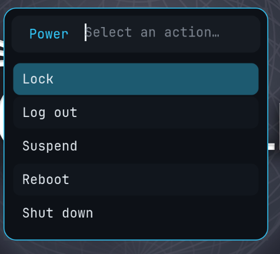

# Kali Hyprland Dotfiles

A clean, compact, keyboard-first Hyprland desktop for Kali Linux (and Debian-based systems).
Dark "glass" bar, real app icons, Windows-style clipboard history, a one-key screenshot tool,
a professional notification center, an A.D./B.S. clock + calendar flyout, and a Thunar
**Set as wallpaper** integration that actually works under Hyprland.



<p>
  
  
  
  
</p>

---

## Table of contents

- [Features](#features)
- [Screenshots](#screenshots)
- [Requirements](#requirements)
- [Installation](#installation)
- [Keybindings](#keybindings)
- [How each piece works](#how-each-piece-works)
- [Customization](#customization)
- [Troubleshooting](#troubleshooting)
- [Project layout](#project-layout)
- [Uninstall](#uninstall)
- [Credits & license](#credits--license)

---

## Features

- **Compact Waybar** - a 30 px bar with **zero gaps** above/below, tight spacing, and a
  translucent dark-glass style. No wasted vertical space.
- **Real app icons for every open window** - the taskbar shows **only the windows on the
  active workspace**, each with its real icon. It stays in sync as you switch workspaces,
  open or close windows. Click to focus, middle-click to close. The highlight marks the
  focused window; background windows are dimmed.
- **Windows-style clipboard history** (`SUPER + V`) - `cliphist` + Rofi, with text **and**
  image thumbnails, search, per-item delete, and one-key **auto-paste** into the focused app.
- **Screenshot tool** (`SUPER + SHIFT + S`) - region selection with a dimmed overlay
  (Windows Snipping Tool style), saved to `~/Pictures/Screenshots`, copied to the clipboard,
  and announced with a preview + quick actions.
- **SwayNC notification center** - a modern, compact panel (content-hugging height, small
  type, slim action pills) instead of the oversized default theme.
- **Clock + calendar flyout** - click the bar clock for a compact popup with a live clock,
  an **A.D.** Gregorian calendar and a **B.S.** Bikram Sambat Nepali calendar
  (Devanagari digits, Nepali month/day names, today highlighting), Nepal time, and the
  ISO week number.
- **Working "Set as wallpaper"** - right-click an image in Thunar and it changes the
  Hyprland wallpaper *and* persists across reboots.
- **Rofi launcher & power menu**, lock screen (`hyprlock`), idle management
  (`hypridle`), polkit agent, and sensible multimedia keys.
- **One-command installer** with backups, package detection, fonts, and desktop defaults.

---

## Screenshots

| Waybar (compact, per-workspace icons) | Notification center |
|---|---|
|  |  |

| Clock + A.D. calendar | B.S. (Nepali) calendar |
|---|---|
|  |  |

| Clipboard history | App launcher | Power menu |
|---|---|---|
|  |  |  |

---

## Requirements

- **Kali Linux** (rolling) or a **Debian-based** distro with the required packages available
  (Arch Linux is also supported by the installer).
- **Hyprland 0.56 or newer**. This config uses Hyprland's **Lua configuration API**
  (`~/.config/hypr/hyprland.lua` and the `hl.*` API). Older Hyprland releases using the
  classic `hyprland.conf` syntax will not parse it.
- **Rofi 2.0+** - needed for native Wayland surfaces (the launcher, clipboard picker and
  power menu all run on Wayland).
- A Wayland session with `pipewire`/`wireplumber` (for `wpctl` volume keys) is recommended.
- Python 3 with **PyGObject** (`python3-gi`, `gir1.2-gtk-3.0`) for the clock flyout,
  **Pillow** (`python3-pil`) for clipboard image thumbnails, and **Pycairo**
  (`python3-cairo`) + **GdkPixbuf** (`gir1.2-gdkpixbuf-2.0`) for the taskbar icon renderer.

Tested against:

| Component | Version |
|---|---|
| Hyprland | 0.56.2 |
| Waybar | 0.15.0 |
| SwayNC | 0.12.6 |
| Rofi | 2.0.0 |
| Thunar | 4.20.10 |
| cliphist | 0.5.0 |

The installer installs everything it can from your package manager, downloads the
**Nerd Fonts symbols** (for the bar/notification glyphs), and installs the
**Papirus** icon theme used by the taskbar icons.

> **Google Chrome** is the configured default browser, but it is not in the Debian/Kali
> repositories. Install it yourself, or run the installer with a browser you already have:
> `BROWSER=chromium ./install.sh` (or `firefox`).

---

## Installation

```bash
git clone https://github.com/dollarboysushil/hyprkali.git
cd hyprkali
./install.sh
```


Then **log out and back in** (or restart Hyprland) so everything loads cleanly.

### Installer options

| Option | Effect |
|---|---|
| `--no-packages` | Skip package installation (config only) |
| `--wallpaper PATH` | Use a specific wallpaper |
| `--no-desktop-shortcut` | Don't copy `shortcut.txt` to `~/Desktop` |
| `--no-reload` | Don't reload the running Hyprland session afterwards |
| `--fix-input-devices` | Opt-in workaround when input dies at login (Kali/Aquamarine) |

### Environment overrides

```bash
BROWSER=chromium TERMINAL=kitty FILE_MANAGER=thunar ./install.sh
```

### What the installer does

1. Installs packages (via `apt` or `pacman`), skipping anything unavailable.
2. Installs the Nerd Font symbols (only if they're missing) and refreshes the font cache.
3. Backs up every file it is about to overwrite to `~/.config-backup-<timestamp>/`.
4. Copies the Hyprland, Waybar, SwayNC and Rofi configs.
5. Renders `hyprpaper.conf` and `hyprlock.conf` against your chosen wallpaper
   (it reuses your **current** wallpaper if it can find one, so nothing is clobbered).
6. Installs the helper scripts to `~/.local/bin` (executable).
7. Installs the B.S. calendar data and the Thunar systemd drop-in.
8. Merges browser/file-manager defaults into `~/.mimeapps.list` (without dropping your
   other entries).
9. Optionally copies the shortcut sheet to `~/Desktop/shortcut.txt`.
10. Reloads Hyprland and restarts Waybar, the taskbar watcher and SwayNC if you're
    already logged in.

With `--fix-input-devices` it also installs the opt-in input workaround described in
[Troubleshooting](#troubleshooting) (root helper + sudo rule + autostart hook).

---

## Keybindings

`SUPER` is the Windows/Super key. The full sheet is installed to
`~/Desktop/shortcut.txt` (source: [`docs/shortcut.txt`](docs/shortcut.txt)).

| Shortcut | Action |
|---|---|
| `SUPER + T` | Terminal (terminator) |
| `SUPER + B` | Browser (google-chrome) |
| `SUPER + F` | File manager (thunar) |
| `SUPER + Space` | App launcher (rofi) |
| `SUPER + SHIFT + Space` | Run a command (rofi) |
| `SUPER + V` | Clipboard history (auto-pastes the selection) |
| `SUPER + SHIFT + S` | Screenshot (region → save + copy) |
| `SUPER + N` | Toggle notification center |
| `SUPER + X` | Power menu |
| `SUPER + L` | Lock screen |
| `SUPER + C` | Close focused window |
| `SUPER + SHIFT + F` | Fullscreen the focused tile |
| `SUPER + SHIFT + V` | Toggle floating |
| `SUPER + P` | Toggle pseudo-tiling |
| `SUPER + J` | Toggle split direction |
| `SUPER + 1…0` | Switch workspace |
| `SUPER + SHIFT + 1…0` | Move window to workspace |
| `SUPER + S` | Toggle scratchpad (special workspace) |
| `SUPER + arrows` | Move focus |
| `SUPER + scroll` | Previous / next workspace |
| `XF86 Audio/Brightness keys` | Volume / mic / media / brightness |

---

## How each piece works

### Waybar

- 30 px tall, full width, `margin-* = 0` so it sits flush against the screen edge.
- **Left:** Hyprland workspaces + a per-workspace taskbar. Waybar's built-in
  `wlr/taskbar` cannot filter by workspace, so the bar uses ten fixed `image` modules
  driven by `scripts/taskbar-watch`. It renders each active-workspace window's real icon
  (Papirus → Flat-Remix → hicolor → a generic fallback), highlights the focused window,
  dims background windows, and updates live when windows open, close or move.
  Empty slots collapse to zero width. Left-click focuses, middle-click closes.
- **Center:** a `clock` module. Its tooltip is disabled - clicking it opens the flyout
  instead of a duplicate calendar tooltip.
- **Right:** tray, network, Bluetooth, volume, CPU, memory, battery, each wired to a
  sensible click action (network → `nm-connection-editor`, Bluetooth → `blueman-manager`,
  volume → `pavucontrol`, right-click volume to mute, scroll to change volume).

### Clock + calendar flyout

- A small GTK3 window (`scripts/clock-popup`) toggled by the bar (`scripts/clock-popup-toggle`),
  positioned just under the clock and **centred on any screen width**
  (`move = "monitor_w/2-165 34"`).
- Shows the time, the Gregorian date, the **Bikram Sambat** date in Devanagari, the numeric
  B.S. date, the ISO week, and the time in **Nepal Time (UTC+05:45)**.
- Two calendar pages switchable with the **A.D. / B.S.** buttons:
  - **A.D.** - standard `Gtk.Calendar`.
  - **B.S.** - a custom grid with Nepali month names, Nepali weekday names, Devanagari day
    numbers, dimmed adjoining-month days and today highlighted. Navigate with the arrows,
    the mouse wheel, or the Left/Right and Home/T keys.
- B.S. data lives in `data/calendar_bs.csv` and covers **1975-2100 B.S.**, generated from
  the known anchor `1975-01-01 B.S. = 1918-04-13 A.D.`
- Closes on focus loss or `Escape`.
- Start it directly on the B.S. page with `CLOCK_POPUP_VIEW=bs` (handy for scripts/tests).

### Clipboard history

- A `wl-paste --watch cliphist store` pair (text + image) runs at login.
- `scripts/clipboard-history` reads `cliphist`, renders image thumbnails with Pillow, and
  shows everything in a compact Rofi picker (search, `Ctrl+Delete` to delete,
  `Ctrl+Shift+Delete` to clear).
- Choosing an entry copies it back to the clipboard and then sends the paste shortcut to
  the focused window (`Ctrl+V`, or `Ctrl+Shift+V` in terminals) - the same behaviour as
  Windows `Win+V`.

### Screenshots

- `scripts/screenshot` uses `grim` + `slurp` for a dimmed region-select overlay, saves to
  `~/Pictures/Screenshots/Screenshot_<date>_<time>.png`, copies it as `image/png` with
  `wl-copy`, and posts a SwayNC notification with a preview and **Open / Open folder**
  actions. Call `screenshot full` for a whole-screen capture.

### Notifications

- SwayNC 0.12 is GTK4, and its default theme is very large (16 px titles, 64 px icons,
  fixed 380×560 panel). This repo ships a compact theme: 10-11 px text, 30 px icons,
  content-hugging height, tight cards, slim action pills, a thin dark-glass border, and a
  red border for critical notifications.
- Panel width/height and content-fit behaviour live in `config/swaync/config.json`.

### Wallpaper (and the Thunar fix)

Thunar's built-in *Set as wallpaper* plugin only does something when
`XDG_CURRENT_DESKTOP=XFCE`, and it writes to the XFCE `xfce4-desktop` settings channel -
which Hyprland ignores entirely. This setup bridges the two:

1. `scripts/thunar` (and a systemd drop-in) launch Thunar with `XDG_CURRENT_DESKTOP=XFCE`
   so the plugin is enabled and writes its backdrop setting.
2. `scripts/wallpaper-watch` watches the `xfce4-desktop` xfconf channel and forwards new
   images to `scripts/wallpaper-set`, which applies them through hyprpaper's IPC for every
   monitor.
3. `wallpaper-set` also rewrites `~/.config/hypr/hyprpaper.conf`, so the choice persists
   across restarts and reboots.

Result: right-click an image in Thunar → **Set as wallpaper** → it just works.

> Thunar offers this menu for PNG, JPEG and SVG images. For other formats, run
> `wallpaper-set /path/to/image.webp` from a terminal.

### Lock, idle and power

- `hyprlock` renders a blurred wallpaper lock screen.
- `hypridle` locks after 4 minutes, turns the screen off after 8, and suspends after 15.
- `powermenu` (Rofi) offers lock / log out / suspend / reboot / shut down with confirmation.

---

## Customization

### Accent colours

The palette is defined in a few places - blue `#33ccff` and green `#00ff99` are the accents:

- `~/.config/waybar/style.css`
- `~/.config/swaync/style.css`
- `~/.config/rofi/hypr.rasi`
- the CSS block at the top of `~/.local/bin/clock-popup`
- `active_border` in `~/.config/hypr/hyprland.lua`

### Monitor and scaling

```lua
hl.monitor({
    output   = "",
    mode     = "preferred",
    position = "auto",
    scale    = 1,          -- 1 = native, 1.25 = a bit larger, 1.5 = zoomed
})
```

Hyprland's `scale = "auto"` rounds a ~140 PPI 1920x1080 laptop panel up to **1.5**,
which makes applications look zoomed. The default here is **1** (native, most screen
space). Use `1.25` if text feels too small, or `1.5` for a touch-friendly layout.

To pin scaling per output, create one block per monitor and set `output` to its name
(e.g. `"eDP-1"`) instead of `""`.

### Default programs

The three variables at the top of `hyprland.lua` control everything:

```lua
local terminal    = "terminator"
local fileManager = "thunar"
local browser     = "google-chrome"
```

You can also set them at install time (`BROWSER=browser TERMINAL=term … ./install.sh`).
Rofi's `terminal` is set in `~/.config/rofi/config.rasi`.

### Clock timezone

The B.S. line and the "NPT" readout use `Asia/Kathmandu` by default. Edit `NEPAL_TZ` in
`~/.local/bin/clock-popup` if you want a different region's clock in the flyout.

### Wallpaper

- Right-click an image in Thunar → **Set as wallpaper**, or
- `wallpaper-set ~/Pictures/Wallpapers/my-image.png`, or
- change the `path` in `~/.config/hypr/hyprpaper.conf` and run
  `hyprctl hyprpaper wallpaper ", /path, cover"`.

---

## Troubleshooting

**The laptop keyboard/touchpad - or all input - is dead after login.**
This is a startup-ordering bug in **Aquamarine < 0.16** (shipped by Kali/Debian with
Hyprland 0.56). Devices already present when Hyprland starts are dispatched to libinput
before the backend is marked ready, and `CSession::onReady()` never re-announces them.
Both built-in and USB devices are affected; replugging a USB device makes it work because
it then appears after startup.

Quick manual fix for the current session:

```bash
sudo udevadm trigger --subsystem-match=input --action=remove
sudo udevadm trigger --subsystem-match=input --action=add
```

To make it automatic at every login, run once:

```bash
./scripts/fix-input-devices.sh
# or, during installation:
./install.sh --fix-input-devices
```

This installs `/usr/local/bin/hypr-input-rebind`, a narrowly scoped
`/etc/sudoers.d/hypr-input-rebind` rule (that script only, with no arguments), and adds
the autostart hook to `hyprland.lua`. It is intentionally **opt-in**: systems that don't
have the bug don't need a sudo rule. `./uninstall.sh` removes it.

**The bar shows boxes/squares instead of icons.**
The Nerd Font symbols aren't installed. The installer downloads them automatically; to do
it manually, install a "Nerd Fonts Symbols" package or drop the font into
`~/.local/share/fonts` and run `fc-cache -f`.

**Taskbar icons are blank or stale.**
The taskbar is rendered by `taskbar-watch`, not `wlr/taskbar`. Check that it is running
(`pgrep -af taskbar-watch`) and restart it with
`pkill -f 'taskbar-watch watch'; setsid taskbar-watch watch &`. It also needs
`python3-cairo` and `gir1.2-gdkpixbuf-2.0` (Arch: `python-cairo`, `python-gobject`).
To force a full icon rebuild, delete `~/.cache/waybar-taskbar` and restart the daemon,
then refresh the bar with `pkill -SIGRTMIN+10 waybar`.
If the whole bar is blank instead of just the icons, make sure the `image#taskN` modules
keep `"interval": "once"` - without it Waybar 0.15 re-runs the module every 1 ms and can
fail to draw the bar.

**The clock flyout doesn't line up under the clock.**
It is positioned with `move = "monitor_w/2-165 34"`. On unusual resolutions or with a
different flyout width, adjust that rule in `hyprland.lua` (the `clock-popup` window rule).

**"Set as wallpaper" in Thunar does nothing.**
Check that `wallpaper-watch` is running (`pgrep -af wallpaper-watch`) and that Thunar has
`XDG_CURRENT_DESKTOP=XFCE` (`systemctl --user show -p Environment thunar.service`).
Test the setter directly: `wallpaper-set ~/Pictures/someimage.png`.

**Clipboard history is empty.**
The `wl-paste --watch cliphist store` autostart entries must be running; verify with
`cliphist list`. Copy something, then try `SUPER + V`.

**Screenshots fail.**
Install `grim` and `slurp`, and make sure the `grim`/`slurp` screencopy permission is
allowed (Hyprland's default config allows it).

**Rofi doesn't appear under Wayland.**
You need **Rofi 2.0+**. Older releases are X11-only.

**`hyprctl dispatch` errors about invalid dispatcher.**
This config targets Hyprland 0.56's Lua API, where dispatchers are Lua expressions such as
`hyprctl dispatch 'hl.dsp.focus({ workspace = "e+1" })'`. On older Hyprland versions the
classic dispatcher syntax differs.

**Notifications are huge again.**
Make sure `~/.config/swaync/style.css` is the one from this repo and restart SwayNC:
`pkill -x swaync && swaync &`, or `swaync-client -rs` to reload the CSS.

---

## Project layout

```
hyprkali/
├── install.sh                     # one-command installer
├── uninstall.sh                   # removes the installed files
├── config/
│   ├── hypr/
│   │   ├── hyprland.lua           # Hyprland (Lua) config
│   │   ├── hypridle.conf
│   │   ├── hyprlock.conf.in       # template (wallpaper substituted at install)
│   │   └── hyprpaper.conf.in      # template (wallpaper substituted at install)
│   ├── waybar/{config.jsonc,style.css}
│   ├── swaync/{config.json,style.css}
│   ├── rofi/{config.rasi,hypr.rasi}
│   └── mimeapps.list
├── scripts/
│   ├── clipboard-history          # Win+V style clipboard picker
│   ├── clock-popup                # GTK3 clock + A.D./B.S. calendar
│   ├── clock-popup-toggle
│   ├── fix-input-devices.sh       # opt-in installer for the input workaround
│   ├── hypr-input-rebind          # re-announces input after Hyprland starts (root)
│   ├── powermenu
│   ├── screenshot                 # grim/slurp capture tool
│   ├── taskbar-watch              # per-workspace Waybar taskbar daemon
│   ├── thunar                     # wrapper that enables the wallpaper plugin
│   ├── wallpaper-set              # apply + persist a wallpaper
│   └── wallpaper-watch            # xfconf → hyprpaper bridge
├── data/calendar_bs.csv           # Bikram Sambat month lengths (1975-2100)
├── systemd/thunar.service.d/wallpaper.conf
├── docs/shortcut.txt              # full keybinding reference
└── assets/screenshots/            # images used in this README
```

---

## Uninstall

```bash
./uninstall.sh          # asks for confirmation
./uninstall.sh --yes    # non-interactive
```

This removes the installed files. Your configuration backups remain in
`~/.config-backup-*`, and `~/.mimeapps.list` / `~/Desktop/shortcut.txt` are left in place.
If you installed the optional input workaround, it also removes
`/usr/local/bin/hypr-input-rebind` and `/etc/sudoers.d/hypr-input-rebind`.

---

## Credits & license

Built for a personal Kali + Hyprland setup and shared so others can use it. It leans on the
excellent work of the Hyprland, Waybar, SwayNC, Rofi, cliphist, Thunar and Nerd Fonts
projects.

Released under the [MIT License](LICENSE).
